# Harpak-ULMA deck skill

The presentation system for Harpak-ULMA, built from Brand Book v0.4. One
repo holds everything a person or an AI agent needs to produce an on-brand
deck: a 55-slide PowerPoint template, the brand rules distilled for slides,
a Claude skill that builds decks from them, and a QA gate that catches
violations before they ship.

Primary use is digital: customer pitches, webinars, partner sessions, and
event decks. Print and large format come later and are flagged where they
touch a decision.

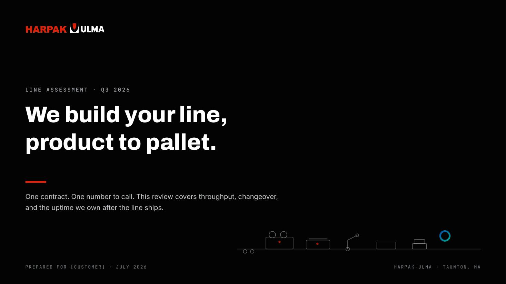

## What's in the template

55 archetype slides in ten sections, in a dark system (the deck master) and
a light system (bright rooms, webinars, the show floor). Covers, agendas,
section and product-line dividers, statements, big numbers, quotes, stat
bands, before/after, bar and line charts, comparison tables, sourced
evidence, card grids, machine and spec layouts, machine lineups, the
product-to-pallet process motif, timelines, roadmaps, industries,
certifications, presenter bios, team grids, partner ecosystem walls with
marks, co-branding contexts, Aura and Aura Edge slides, demo frames, case
studies, commercial options, FAQ, closers that end on the ask, and the
legal appendix. Slide 04 indexes the set; every slide's speaker notes carry
its usage rules.

The line motif is built from eight equipment silhouette glyphs (Brand Book
v0.4, Section 6.A.10): the real machine classes on a shared baseline, with
the Aura ring floated at the end. Glyphs carry the process motif, the
product-line dividers, the closings, and the machine slides; they inherit
the surface text color (neutral on dark, ink on light).

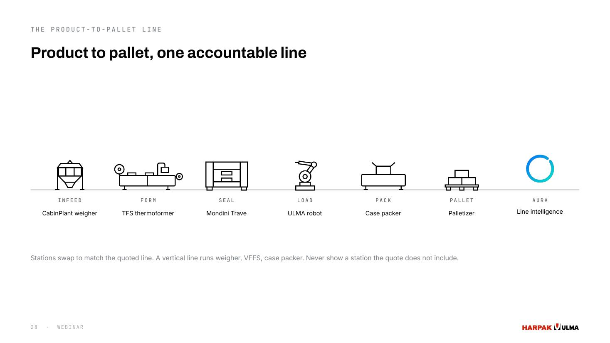
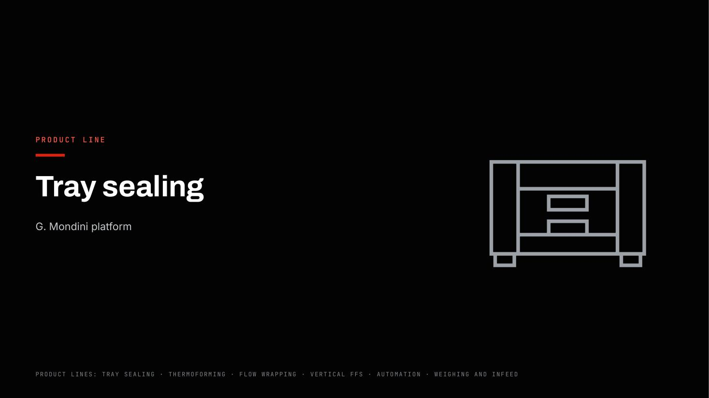

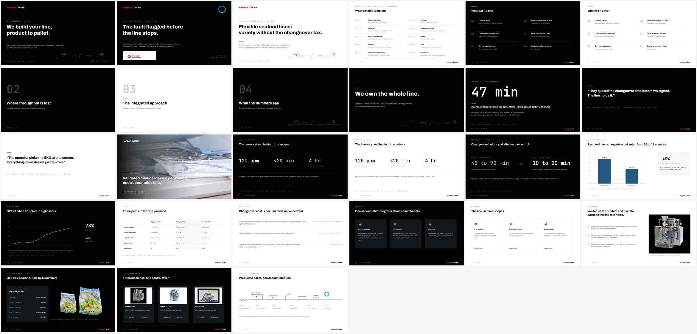
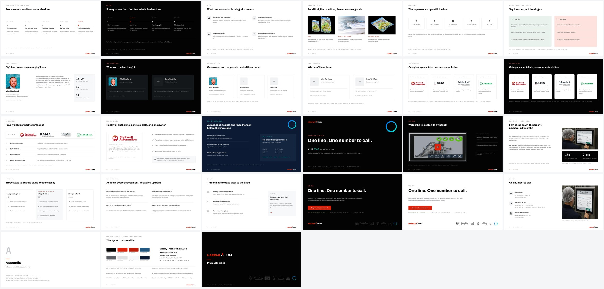

| | |
|---|---|
| 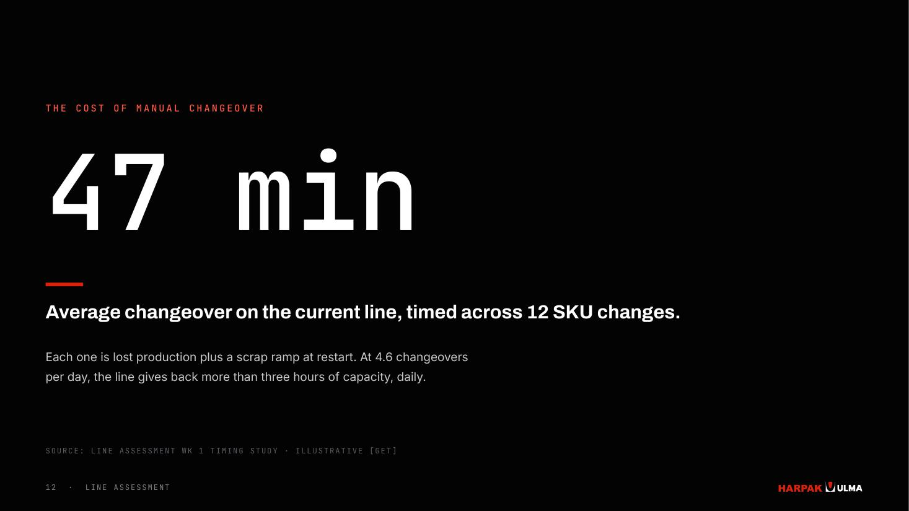 | 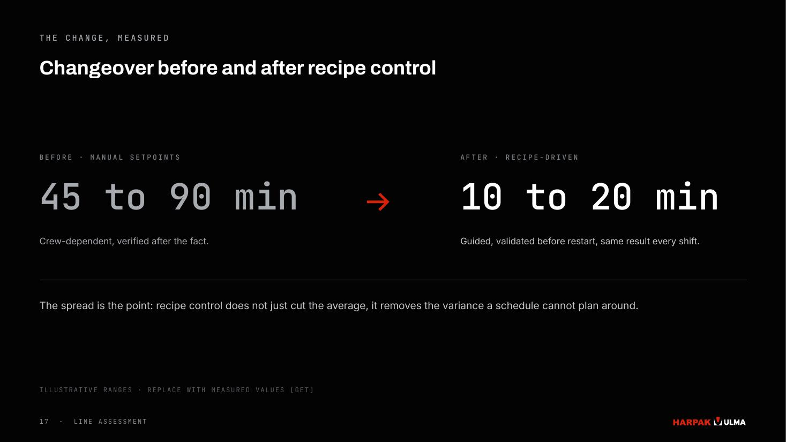 |
| 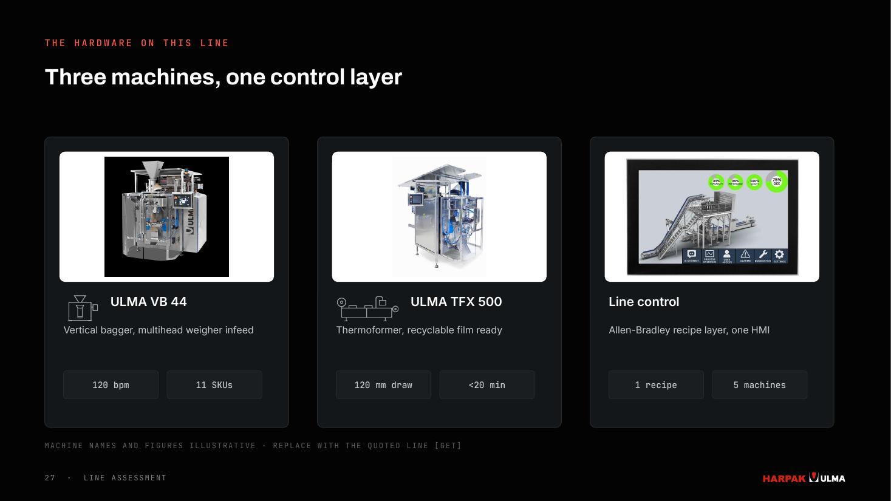 | 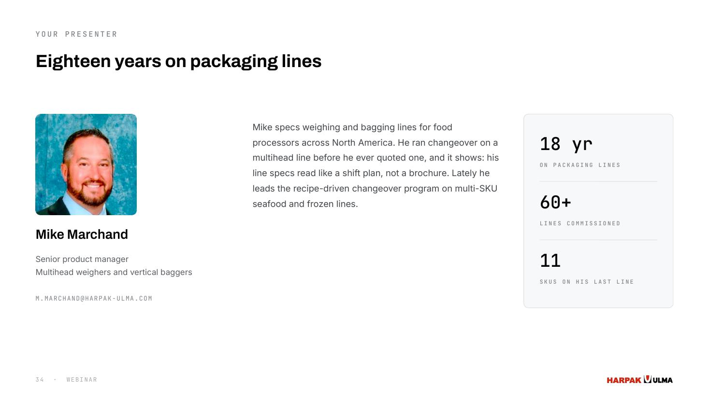 |
| 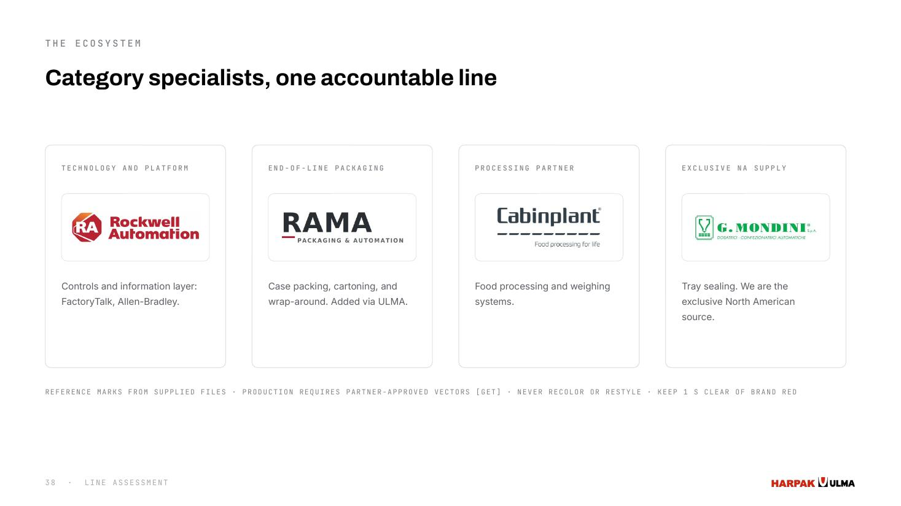 | 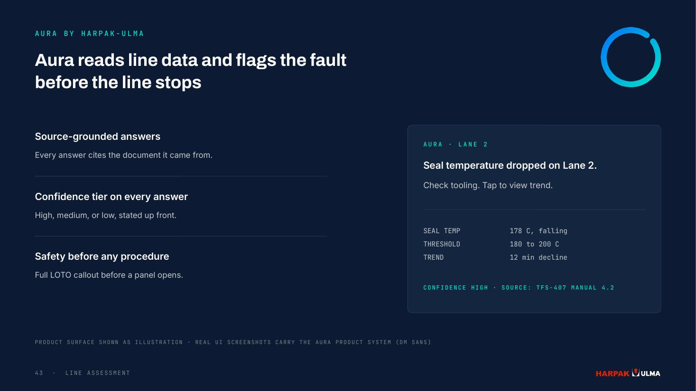 |

## Use it as a person

1. Install the fonts once: `assets/fonts/` (Archivo, Inter, JetBrains
   Mono; free, SIL OFL). Instructions in `assets/fonts/FONTS.md`.
2. Open `assets/template/Harpak-ULMA-Deck-Template.pptx`. Its images are
   embedded, so it opens ready to edit with no setup.
3. Keep the slides you need, duplicate archetypes for more, refill the
   text. The speaker notes on every slide tell you what to change and what
   to leave alone.
4. Delete slides 04 (index) and 54 (cheat sheet) before presenting, and
   resolve every visible [GET] tag: those mark figures that need verified
   values.

## Regenerate assets (only if rebuilding decks in code)

To keep the source tree small and reviewable, the repo commits only the
asset masters: one monochrome PNG per icon (`assets/icons/*-ink.png`), the
eight equipment glyph SVGs (`assets/glyphs/`), and the photo scrims. The
colored icon variants, glyph PNGs, and line-motif strips are generated:

```bash
pip install pillow cairosvg
python scripts/render_assets.py
```

You only need this when rebuilding a deck with `scripts/build_template.js`.
Opening the shipped `.pptx` does not require it. (The installable `.skill`
release ships every asset pre-rendered, so it works with no render step.)

## Use it with Claude

The repo root is a Claude Agent Skill.

- Claude Code: clone into your skills directory, or
  `npx skills add <this-repo-url>`.
- claude.ai and Cowork: download `dist/harpak-ulma-decks.skill` from this
  repo and upload it to your skills, or attach the repo to a project.

Then ask for any Harpak-ULMA deck ("build the Pack Expo session deck",
"turn this outline into a customer pitch"). The skill plans the narrative
before touching slides, builds from the template archetypes, writes in the
brand voice, applies the partner and Aura compliance rules, and runs the
QA gate before delivering.

## The rules, in one paragraph

Headlines are claims in sentence case, 12 words max, and the headline
chain alone must carry the argument. One idea per slide, 40 words of body
max. One red element per slide; red is the action color. Every figure,
unit, and part number is set in JetBrains Mono; ranges use "to", never a
dash, and no em-dashes anywhere. Every performance figure is verified or
carries a [GET] tag. Banned words never ship. Partner marks live on
neutral cards, never recolored, with 1 S of separation from brand red.
Aura stays contained: navy surface, the gradient ring as the only
gradient, signature "Aura by Harpak-ULMA". The last slide is the ask.
Full detail: `references/`.

## QA gate

```bash
python scripts/brand_check.py your-deck.pptx
```

Scans every slide and speaker note for banned words, em-dashes, dash
ranges, off-brand fonts, type below 7.5 pt, and leftover placeholders;
fails any deck that re-embeds the retired wireframe motif (matched by
content hash) or a glyph SVG with a baked hex color; and lists open [GET]
items. Exit code 1 on any FAIL. Run it before anything ships.

## Repo layout

```
SKILL.md               The Claude skill: workflow and rules
references/            Brand system, archetype map, voice, partner/Aura rules
scripts/               brand_check.py (QA), tokens.js, build_template.js,
                       render_assets.py (regenerates colored assets)
assets/template/       The 55-slide .pptx template (images embedded)
assets/fonts/          Brand fonts + install kit + OFL license
assets/glyphs/         Eight equipment glyph SVG masters (v0.4 6.A.10)
assets/icons/          Icon masters (*-ink.png); colors regenerate
assets/logos|motif|photos|partners/   Lockups, scrims, photography, marks
dist/                  Installable harpak-ulma-decks.skill (claude.ai upload)
evals/                 Test prompt and benchmark from skill development
docs/preview/          Rendered previews used above
```

## Governance

Brand Book v0.4 is a draft for marketing ratification; most decisions are
PROPOSED and tagged. The equipment glyph system (6.A.10) is CONFIRMED
canon; the dark-surface eyebrow color #FF5A46 is PROPOSED and carried on
the open list. The lockups here are interim vectors rebuilt from the
in-use site mark, standing in until the commissioned vector master ships.
Partner marks are reference rasters: production use requires each
partner's approved vector files and guidelines. Aura and Aura Edge naming
is subject to counsel clearance; nothing in this repo asserts trademark
availability. Illustrative figures carry [GET] tags and are replaced with
product-verified values before external use.

Fonts are redistributed under the SIL Open Font License
(`assets/fonts/OFL.txt`). Everything else in this repo is internal
Harpak-ULMA marketing material.
